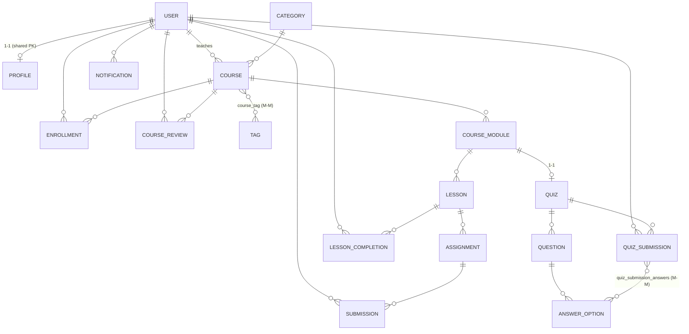

# Learning Platform. Учебная платформа на Spring Boot и Hibernate

Серверное приложение для онлайн-школы. Оно ведет курсы, модули, уроки, домашние задания и тесты. Студенты записываются
на курсы, сдают решения, проходят тесты и оставляют отзывы. Преподаватели проверяют работы. Аналитика считает
успеваемость и рейтинги.

Проект демонстрирует работу с JPA/Hibernate:

- 17 сущностей со связями 1-1, 1-M и M-M, все ассоциации ленивые;
- `LazyInitializationException` воспроизводится тестом, и показаны способы его избежать;
- N+1 закрыт тестами с подсчётом SQL-запросов;
- каскады, orphan removal, ограничения БД;
- проекции JPQL и Specifications.
- вход по JWT (Spring Security, OAuth 2 Resource Server). У студента, преподавателя и админа свои права;
- email уведомления о записи на курс, новых заданиях, оценках и результатах тестов (Spring Mail, Mailpit);
- аналитика, Swagger UI и веб-интерфейс с входом под ролями.

## Содержание

1. [Стек](#стек)
2. [Быстрый старт](#быстрый-старт)
3. [Конфигурация и профили](#конфигурация-и-профили)
4. [Демо-данные](#демо-данные)
5. [REST API](#rest-api)
6. [Безопасность](#безопасность)
7. [Email-уведомления](#email-уведомления)
8. [Архитектура](#архитектура)
9. [Модель данных](#модель-данных)
10. [Ленивая загрузка](#ленивая-загрузка)
11. [Бизнес-правила](#бизнес-правила)
12. [Тестирование](#тестирование)
13. [CI и Docker](#ci-и-docker)

## Стек

| Компонент                                              | Версия         |
|--------------------------------------------------------|----------------|
| Java                                                   | 21             |
| Spring Boot (Web, Data JPA, Validation, Actuator)      | 3.5            |
| Hibernate ORM                                          | 6.6            |
| PostgreSQL                                             | 16             |
| Spring Security + OAuth2 Resource Server (JWT, Nimbus) | 6.5            |
| Spring Mail (Jakarta Mail), Mailpit                    | —              |
| springdoc-openapi (Swagger UI)                         | 2.8            |
| Lombok                                                 | —              |
| JUnit 5, Mockito, AssertJ, MockMvc                     | —              |
| Testcontainers, GreenMail, spring-security-test        | 1.21 / 2.1 / — |
| JaCoCo, Checkstyle                                     | 0.8 / 10.26    |

## Быстрый старт

### Вариант 1. Docker Compose (реком.)

Нужен только Docker.

```bash
docker compose up -d --build
```

После старта доступны:

| Что                       | Адрес                                                                      |
|---------------------------|----------------------------------------------------------------------------|
| Веб-интерфейс             | http://localhost:8080                                                      |
| Swagger UI                | http://localhost:8080/swagger-ui.html                                      |
| OpenAPI JSON              | http://localhost:8080/v3/api-docs                                          |
| Health                    | http://localhost:8080/actuator/health                                      |
| Mailpit (входящие письма) | http://localhost:8025                                                      |
| PostgreSQL                | `localhost:5433`, БД `learning_platform`, пользователь и пароль `platform` |

Схема БД создаётся автоматически, демо-данные загружаются при первом запуске.

Чтобы поменять пароль или порты, скопируйте `.env.example` в `.env` и измените значения.

Остановка:

```bash
docker compose down
```

Остановка с удалением данных:

```bash
docker compose down -v
```

### Вариант 2. Локально с Maven

Требуются JDK 21 и PostgreSQL. Если PostgreSQL не установлен, запустите только контейнер с БД:

```bash
docker compose up -d db
```

Если используете свой PostgreSQL, создайте бд и пользователя:

```sql
create user platform with password 'platform';
create database learning_platform owner platform;
```

Запуск (профиль `dev` по умолчанию):

```bash
DB_URL=jdbc:postgresql://localhost:5433/learning_platform mvn spring-boot:run
```

Без `DB_URL` профиль `dev` подключается к `localhost:5432`.

Сборка jar:

```bash
mvn -B package -DskipTests
java -jar target/learning-platform-1.0.0.jar
```

## Конфигурация и профили

Хардкода параметров подключения в коде нет: всё задаётся в `application*.yml` через переменные окружения.

| Профиль              | Файл                                      | Назначение                                                                                        |
|----------------------|-------------------------------------------|---------------------------------------------------------------------------------------------------|
| `dev` (по умолчанию) | `application-dev.yml`                     | Локальная разработка. Есть дефолты подключения, демо-данные, DEBUG-логи приложения.               |
| `test`               | `src/test/resources/application-test.yml` | Интеграционные тесты. `create-drop`, статистика Hibernate для подсчёта запросов, без демо-данных. |
| `prod`               | `application-prod.yml`                    | Без дефолтов для БД: переменные обязательны. Swagger выключен.                                    |

| Переменная                         | По умолчанию                                                      | Описание                                                                                              |
|------------------------------------|-------------------------------------------------------------------|-------------------------------------------------------------------------------------------------------|
| `SPRING_PROFILES_ACTIVE`           | `dev`                                                             | Активный профиль                                                                                      |
| `DB_URL`                           | `jdbc:postgresql://localhost:5432/learning_platform` (dev)        | JDBC URL                                                                                              |
| `DB_USERNAME` / `DB_PASSWORD`      | `platform` / `platform` (dev)                                     | Учётные данные БД                                                                                     |
| `DB_POOL_SIZE`                     | `10`                                                              | Размер пула HikariCP                                                                                  |
| `JPA_DDL_AUTO`                     | `update`                                                          | Стратегия генерации схемы Hibernate                                                                   |
| `DEMO_DATA_ENABLED`                | `true` в dev, `false` в остальных                                 | Загрузка демо-данных                                                                                  |
| `SQL_LOG_LEVEL`                    | `INFO`                                                            | `DEBUG` выводит SQL Hibernate в лог                                                                   |
| `SERVER_PORT`                      | `8080`                                                            | HTTP-порт                                                                                             |
| `SWAGGER_ENABLED`                  | `false` (prod)                                                    | Swagger в профиле prod                                                                                |
| `JWT_SECRET`                       | есть только в dev, в compose свой                                 | Ключ HMAC-SHA256 для подписи токенов, не короче 32 символов. Без него приложение вне dev не стартует. |
| `JWT_TTL`                          | `PT2H`                                                            | Время жизни токена (ISO-8601)                                                                         |
| `JWT_ISSUER`                       | `learning-platform`                                               | Claim `iss`. Токены с другим издателем отклоняются.                                                   |
| `DEMO_PASSWORD`                    | `learning123`                                                     | Пароль всех демо-пользователей                                                                        |
| `MAIL_ENABLED`                     | `false`, в compose `true`                                         | Отправка email-уведомлений                                                                            |
| `MAIL_HOST` / `MAIL_PORT`          | `localhost` / `1025`, в compose `mailpit` / `1025`                | SMTP-сервер                                                                                           |
| `MAIL_USERNAME` / `MAIL_PASSWORD`  | пусто                                                             | Учетные данные SMTP                                                                                   |
| `MAIL_SMTP_AUTH` / `MAIL_STARTTLS` | `false`                                                           | SMTP AUTH и STARTTLS для реального почтового сервера                                                  |
| `MAIL_FROM`                        | `no-reply@learning.local`                                         | Адрес отправителя                                                                                     |

Ключевые настройки JPA в `application.yml`:

- `spring.jpa.open-in-view: false` — сессия не живет до конца запроса;
- `hibernate.default_batch_fetch_size: 50` — пакетная подгрузка ленивых связей;
- `hibernate.jdbc.batch_size: 50`, `order_inserts`, `order_updates` — пакетные вставки;
- `hibernate.jdbc.time_zone: UTC`.

## Демо данные

Демо-данные загружает `DemoDataInitializer` (`ApplicationRunner`), если `app.demo-data.enabled=true` и таблица `users`
пустая. Повторный запуск ничего не дублирует.

Данные создаются через сервисный слой, поэтому срабатывают те же проверки и события, что и при работе через API.

| Роль    | Пользователи                                                                             |
|---------|------------------------------------------------------------------------------------------|
| ADMIN   | `admin@learning.local`                                                                   |
| TEACHER | Ирина Смирнова `irina.smirnova@learning.local`, Павел Орлов `pavel.orlov@learning.local` |
| STUDENT | Анна `anna@learning.local`, Борис `boris@learning.local`, Вера `vera@learning.local`     |

У всех демо-пользователей пароль `learning123`. Его меняет переменная `DEMO_PASSWORD`. Это пароль только для
демо-стенда, в prod демо-данные выключены.

Что ещё создаётся:

- 2 категории и 6 тегов;
- 3 курса:
    - «Основы Hibernate» — опубликован, 2 модуля по 2 урока, тесты к модулям;
    - «SQL для разработчиков» — опубликован;
    - «Spring Data JPA: продвинутый уровень» — черновик;
- задания, в том числе с прошедшим дедлайном (решение помечается как `late`);
- записи студентов, пройденные уроки, оценённые решения;
- попытки тестов, в том числе проваленная;
- отзывы и уведомления.

ID генерируются последовательностями. Актуальные значения смотрите через `GET /api/users` и `GET /api/courses`.

## REST API

Полная интерактивная документация — в Swagger UI (`/swagger-ui.html`). Ошибки возвращаются в формате RFC 7807 (
`application/problem+json`).

### Коды ответов

| Код                                             | Когда                                                                                                                                       |
|-------------------------------------------------|---------------------------------------------------------------------------------------------------------------------------------------------|
| `200 OK`                                        | Успешное чтение или изменение                                                                                                               |
| `201 Created` + `Location`                      | Ресурс создан                                                                                                                               |
| `204 No Content`                                | Удаление, отписка, отметка урока                                                                                                            |
| `401 Unauthorized` + `WWW-Authenticate: Bearer` | Нет токена, токен неверный, истёк или выпущен другим издателем. Неверный логин или пароль.                                                  |
| `403 Forbidden`                                 | Токен есть, но роли или владения ресурсом не хватает                                                                                        |
| `400 Bad Request`                               | Ошибка валидации тела или параметров (поле `errors`: поле → сообщение), битый JSON, неверный тип параметра                                  |
| `404 Not Found`                                 | Сущность не найдена                                                                                                                         |
| `405 Method Not Allowed`                        | Неподдерживаемый HTTP-метод                                                                                                                 |
| `409 Conflict`                                  | Дубликат: email, повторная запись, повторное решение, повторный отзыв. Удаление сущности, на которую есть ссылки. Нарушение ограничения БД. |
| `422 Unprocessable Entity`                      | Нарушено бизнес-правило: курс не опубликован, нет записи на курс, исчерпаны попытки, балл больше максимального, неверная роль               |
| `500`                                           | Непредвиденная ошибка (без деталей наружу)                                                                                                  |

Пример ошибки валидации:

```json
{
    "type": "about:blank",
    "title": "Validation failed",
    "status": 400,
    "detail": "Request body is invalid",
    "instance": "/api/courses",
    "timestamp": "2026-11-10T12:00:00Z",
    "errors": {
        "title": "must not be blank",
        "categoryId": "must not be null"
    }
}
```

### Эндпоинты

Права доступа к каждому эндпоинту описаны в разделе [Безопасность](#безопасность).

| Метод                 | Путь                                                                        | Описание                                                                |
|-----------------------|-----------------------------------------------------------------------------|-------------------------------------------------------------------------|
| **Аутентификация**    |                                                                             |                                                                         |
| POST                  | `/api/auth/register`                                                        | Самостоятельная регистрация, всегда с ролью `STUDENT`                   |
| POST                  | `/api/auth/login`                                                           | Вход: `{email, password}` → `{accessToken, tokenType, expiresIn, user}` |
| GET                   | `/api/auth/me`                                                              | Текущий пользователь по токену                                          |
| **Пользователи**      |                                                                             |                                                                         |
| GET                   | `/api/users?role=&page=&size=`                                              | Список с фильтром по роли                                               |
| GET, PUT, DELETE      | `/api/users/{id}`                                                           | Чтение, обновление, удаление                                            |
| POST                  | `/api/users`                                                                | Создание                                                                |
| GET, PUT              | `/api/users/{id}/profile`                                                   | Профиль (1-1), PUT создаёт или обновляет                                |
| GET                   | `/api/users/{id}/enrollments`                                               | Курсы студента                                                          |
| GET                   | `/api/users/{id}/assignments`                                               | Задания студента по всем курсам вместе с его решениями                  |
| GET                   | `/api/users/{id}/submissions`                                               | Решения студента                                                        |
| GET                   | `/api/users/{id}/quiz-submissions`                                          | Результаты тестов студента                                              |
| GET                   | `/api/users/{id}/notifications?unreadOnly=`                                 | Уведомления                                                             |
| PATCH                 | `/api/notifications/{id}/read`                                              | Отметить уведомление прочитанным                                        |
| **Каталог**           |                                                                             |                                                                         |
| GET, POST             | `/api/categories`                                                           | Категории                                                               |
| GET, PUT, DELETE      | `/api/categories/{id}`                                                      | Категория                                                               |
| GET, POST             | `/api/tags`                                                                 | Теги                                                                    |
| DELETE                | `/api/tags/{id}`                                                            | Удалить тег                                                             |
| **Курсы и контент**   |                                                                             |                                                                         |
| GET                   | `/api/courses?query=&status=&categoryId=&teacherId=&tag=&page=&size=&sort=` | Поиск с фильтрами и пагинацией                                          |
| POST                  | `/api/courses`                                                              | Создать курс; модули и уроки можно передать в том же запросе            |
| GET                   | `/api/courses/{id}`                                                         | Курс со структурой модулей, уроков и тестов                             |
| PUT, DELETE           | `/api/courses/{id}`                                                         | Обновить, удалить                                                       |
| PUT, DELETE           | `/api/courses/{id}/tags/{tagId}`                                            | Привязать или отвязать тег (M-M)                                        |
| POST                  | `/api/courses/{id}/modules`                                                 | Добавить модуль                                                         |
| GET, PUT, DELETE      | `/api/modules/{id}`                                                         | Модуль                                                                  |
| POST                  | `/api/modules/{id}/lessons`                                                 | Добавить урок                                                           |
| GET, PUT, DELETE      | `/api/lessons/{id}`                                                         | Урок                                                                    |
| POST                  | `/api/lessons/{id}/complete?user=`                                          | Отметить урок пройденным                                                |
| **Запись на курс**    |                                                                             |                                                                         |
| POST                  | `/api/courses/{id}/enroll?user=`                                            | Записать студента                                                       |
| DELETE                | `/api/courses/{id}/enroll?user=`                                            | Отписать студента                                                       |
| GET                   | `/api/courses/{id}/students`                                                | Студенты курса                                                          |
| PATCH                 | `/api/enrollments/{id}`                                                     | Сменить статус (`ACTIVE` / `COMPLETED`)                                 |
| **Задания и решения** |                                                                             |                                                                         |
| GET, POST             | `/api/lessons/{id}/assignments`                                             | Задания урока                                                           |
| GET, PUT, DELETE      | `/api/assignments/{id}`                                                     | Задание                                                                 |
| POST                  | `/api/assignments/{id}/submit`                                              | Отправить решение                                                       |
| GET                   | `/api/assignments/{id}/submissions`                                         | Решения по заданию                                                      |
| GET, DELETE           | `/api/submissions/{id}`                                                     | Решение; DELETE отзывает его, пока оно не оценено                       |
| PUT                   | `/api/submissions/{id}/grade`                                               | Оценить                                                                 |
| **Тесты**             |                                                                             |                                                                         |
| POST, GET             | `/api/modules/{id}/quiz?includeAnswers=`                                    | Создать или получить тест модуля (1-1)                                  |
| GET, DELETE           | `/api/quizzes/{id}?includeAnswers=`                                         | Тест. Правильные ответы скрыты, если не передан `includeAnswers=true`.  |
| POST                  | `/api/quizzes/{id}/questions`                                               | Добавить вопрос                                                         |
| DELETE                | `/api/questions/{id}`                                                       | Удалить вопрос                                                          |
| POST                  | `/api/quizzes/{id}/take`                                                    | Пройти тест                                                             |
| GET                   | `/api/quizzes/{id}/submissions`                                             | Результаты по тесту                                                     |
| GET                   | `/api/courses/{id}/quiz-submissions`                                        | Результаты тестов по курсу                                              |
| **Отзывы**            |                                                                             |                                                                         |
| GET, POST             | `/api/courses/{id}/reviews`                                                 | Отзывы курса                                                            |
| DELETE                | `/api/reviews/{id}`                                                         | Удалить отзыв                                                           |
| **Аналитика**         |                                                                             |                                                                         |
| GET                   | `/api/analytics/courses/{id}`                                               | Статистика курса: записи, рейтинг, средний балл, доля сдавших тесты     |
| GET                   | `/api/analytics/courses/{id}/leaderboard?limit=`                            | Рейтинг студентов по сумме баллов                                       |
| GET                   | `/api/analytics/courses/popular?limit=`                                     | Популярные курсы                                                        |
| GET                   | `/api/analytics/students/{id}/progress`                                     | Успеваемость студента по всем курсам                                    |

### Сквозной сценарий через curl

Сценарий работает на демо-стенде: администратор берется из демо данных, преподаватель будет администратором, студент
регистрируется сам.

```bash
API=http://localhost:8080/api
JSON='Content-Type: application/json'
login() {
  curl -s -X POST $API/auth/login -H "$JSON" -d "{\"email\":\"$1\",\"password\":\"$2\"}" | jq -r .accessToken
}

ADMIN=$(login admin@learning.local learning123)
TEACHER=$(curl -s -X POST $API/users -H "$JSON" -H "Authorization: Bearer $ADMIN" \
  -d '{"name":"Мария","email":"maria@example.com","password":"maria-pass-1","role":"TEACHER"}' | jq .id)
STUDENT=$(curl -s -X POST $API/auth/register -H "$JSON" \
  -d '{"name":"Олег","email":"oleg@example.com","password":"oleg-pass-1"}' | jq .id)
CATEGORY=$(curl -s -X POST $API/categories -H "$JSON" -H "Authorization: Bearer $ADMIN" \
  -d '{"name":"Java"}' | jq .id)

T=(-H "$JSON" -H "Authorization: Bearer $(login maria@example.com maria-pass-1)")
S=(-H "$JSON" -H "Authorization: Bearer $(login oleg@example.com oleg-pass-1)")

COURSE_JSON=$(curl -s -X POST $API/courses "${T[@]}" -d "{
  \"title\":\"JPA за неделю\",\"categoryId\":$CATEGORY,\"teacherId\":$TEACHER,\"status\":\"PUBLISHED\",
  \"modules\":[{\"title\":\"Маппинг\",\"lessons\":[{\"title\":\"@Entity\"},{\"title\":\"Связи\"}]}]}")
COURSE=$(echo $COURSE_JSON | jq .course.id)
MODULE=$(echo $COURSE_JSON | jq '.modules[0].id')
LESSON=$(echo $COURSE_JSON | jq '.modules[0].lessons[0].id')

curl -s -X POST "$API/courses/$COURSE/enroll?user=$STUDENT" "${S[@]}"
curl -s -X POST "$API/lessons/$LESSON/complete?user=$STUDENT" "${S[@]}"

ASSIGNMENT=$(curl -s -X POST $API/lessons/$LESSON/assignments "${T[@]}" \
  -d '{"title":"Смаппить Course","maxScore":100}' | jq .id)
SUBMISSION=$(curl -s -X POST $API/assignments/$ASSIGNMENT/submit "${S[@]}" \
  -d "{\"studentId\":$STUDENT,\"content\":\"@Entity class Course {}\"}" | jq .id)
curl -s -X PUT $API/submissions/$SUBMISSION/grade "${S[@]}" -d '{"score":100}' | jq .status
curl -s -X PUT $API/submissions/$SUBMISSION/grade "${T[@]}" -d '{"score":90,"feedback":"Отлично"}'

QUIZ_JSON=$(curl -s -X POST $API/modules/$MODULE/quiz "${T[@]}" -d '{
  "title":"Проверка","passingScore":60,"maxAttempts":2,
  "questions":[{"text":"FetchType по умолчанию у @OneToMany?","type":"SINGLE_CHOICE",
    "options":[{"text":"LAZY","correct":true},{"text":"EAGER","correct":false}]}]}')
QUIZ=$(echo $QUIZ_JSON | jq .id)
QUESTION=$(echo $QUIZ_JSON | jq '.questions[0].id')
OPTION=$(echo $QUIZ_JSON | jq '.questions[0].options[0].id')
curl -s -X POST $API/quizzes/$QUIZ/take "${S[@]}" \
  -d "{\"studentId\":$STUDENT,\"answers\":{\"$QUESTION\":[$OPTION]}}"

curl -s $API/analytics/students/$STUDENT/progress "${S[@]}" | jq
curl -s "$API/users/$STUDENT/notifications?unreadOnly=true" "${S[@]}" | jq
```

Попытка студента оценить свою работу возвращает `403`. Письма Олегу о записи, новом задании, оценке и результате теста
видны в Mailpit – http://localhost:8025.

### Веб

`http://localhost:8080/` — одна страница на vanilla JS (`src/main/resources/static/index.html`). Возможности:

- поиск курсов по названию, статусу и категории;
- список популярных курсов;
- вход по email и паролю, кнопки быстрого выбора демо-аккаунтов. Токен хранится в `localStorage`, при `401` сессия
  сбрасывается;
- гость видит каталог, популярные курсы, структуру курсов и отзывы. Черновики (`DRAFT`) видны только их преподавателю и
  администратору;
- студент записывается на курс и отписывается, видит свой прогресс и уведомления;
- преподаватель своего курса и администратор видят статистику, список студентов и могут отписывать студентов;
- интерфейс показывает только разрешённые действия. Окончательную проверку прав делает сервер.

## Безопасность

Spring Security в режиме stateless: сессий и cookie нет, поэтому CSRF-защита не нужна и выключена. Каждый запрос несёт
`Authorization: Bearer <JWT>`.

**Как устроено:**

- `POST /api/auth/login` проверяет пароль (BCrypt) и выдаёт JWT, подписанный HS256 через `NimbusJwtEncoder`.
    - Claims: `sub` = id пользователя, `role`, `email`, `name`, `iss`, `iat`, `exp`.
    - Время жизни задаёт `JWT_TTL`.
- Токен проверяет OAuth2 Resource Server (`NimbusJwtDecoder`): подпись, срок действия и издатель. Claim `role`
  превращается в authority `ROLE_<role>`.
- Пароли хранятся только в виде BCrypt-хеша (`users.password_hash`) и в ответы API не попадают.
- Для неизвестного email тоже сверяется фиктивный хеш. Так по времени ответа нельзя узнать, какие email
  зарегистрированы. Ответ один: `401 Invalid email or password`.
- Регистрация через `/api/auth/register` всегда создаёт `STUDENT`. Поле `role` в теле игнорируется. Преподавателей и
  администраторов создаёт администратор через `POST /api/users`.
- Права проверяются в два уровня:
    - URL-правила в `SecurityConfig` разделяют публичные и закрытые пути;
    - `@PreAuthorize` на методах контроллеров проверяет роль и владение ресурсом через бин `AccessPolicy` (`@access`).
      Владелец определяется лёгкими запросами `findTeacherIdById` / `findStudentIdById`, без загрузки графа сущностей.
- Если ресурса нет, `AccessPolicy` пропускает запрос дальше, и сервис возвращает `404`, а не `403`.
- Черновик курса (`DRAFT`) виден только его преподавателю и администратору. Для остальных он исключается из поиска
  (`AccessPolicy.visibleCourses` → `Specification`) и из популярных курсов, а `GET /api/courses/{id}` и отзывы отвечают `404`, чтобы не
  раскрывать сам факт существования черновика.
- Ошибки `401` и `403` приходят в том же формате ProblemDetail, что и остальные. `401` дополнительно содержит заголовок
  `WWW-Authenticate: Bearer`.
- В Swagger UI есть кнопка **Authorize**: вставьте `accessToken`, и все запросы пойдут с токеном.

**Матрица доступа** (ADMIN может всё):

| Действие                                                                                               | Гость | STUDENT        | TEACHER                                |
|--------------------------------------------------------------------------------------------------------|-------|----------------|----------------------------------------|
| Каталог курсов, категории, теги, отзывы, популярные курсы, Swagger, health                             | да    | да             | да                                     |
| Черновики курсов (`DRAFT`) в каталоге и по id                                                          | нет   | нет            | только свои                            |
| Регистрация, вход                                                                                      | да    | —              | —                                      |
| Изменить свои данные и профиль, читать уведомления                                                     | —     | только свои    | только свои                            |
| Курсы, задания, решения и тесты студента, его успеваемость                                             | —     | только свои    | да, любого студента                    |
| Список пользователей                                                                                   | —     | нет            | да                                     |
| Создать пользователя с любой ролью, удалить пользователя, управлять категориями, удалить тег           | —     | нет            | нет                                    |
| Создать тег                                                                                            | —     | нет            | да                                     |
| Создать курс                                                                                           | —     | нет            | только на себя (`teacherId` = свой id) |
| Изменять или удалять курс, модули, уроки, задания, тесты, теги курса                                   | —     | нет            | только в своих курсах                  |
| Статистика курса, список студентов курса, решения по заданию, результаты тестов курса, тест с ответами | —     | нет            | только по своим курсам                 |
| Оценить решение, сменить статус записи                                                                 | —     | нет            | только в своих курсах                  |
| Записаться на курс, пройти урок, отправить решение, пройти тест, оставить отзыв                        | —     | только за себя | нет (нужна роль STUDENT)               |
| Отписаться                                                                                             | —     | только себя    | отписать студента от своего курса      |
| Отозвать решение, удалить отзыв                                                                        | —     | только своё    | нет                                    |
| Рейтинг курса по заданиям                                                                              | —     | да             | да                                     |

## Email-уведомления

Этап 5 ТЗ: студент получает письмо, когда записался на курс, когда в курсе появилось новое задание, когда его работу
оценили и когда он прошёл тест.

Как это работает:

1. Бизнес-сервис публикует доменное событие, например `SubmissionGradedEvent`.
2. `NotificationService` сохраняет уведомление в БД (in-app) и публикует `NotificationCreatedEvent`.
3. `EmailNotificationSender` принимает его через `@TransactionalEventListener` (фаза `AFTER_COMMIT`) и `@Async`:
    - письмо уходит только после коммита транзакции. Если бизнес-операция откатилась, письма не будет;
    - SMTP не задерживает HTTP-ответ;
    - ошибка SMTP (`MailException`) пишется в лог и не ломает бизнес-операцию. Уведомление остаётся в БД.
4. Бин отправителя создаётся только при `MAIL_ENABLED=true` (`@ConditionalOnProperty`). Без почтового сервера приложение
   работает как прежде.

В `docker compose` поднимается [Mailpit](https://mailpit.axllent.org/) — SMTP-ловушка с веб-интерфейсом. Все письма
видны на http://localhost:8025, наружу ничего не уходит. Для реального SMTP задайте `MAIL_HOST`, `MAIL_PORT`,
`MAIL_USERNAME`, `MAIL_PASSWORD`, `MAIL_SMTP_AUTH=true`, `MAIL_STARTTLS=true`.

Тесты:

- `EmailNotificationIntegrationTest` поднимает встроенный SMTP-сервер GreenMail. Он проверяет, что после записи, нового
  задания и оценки студент получает три письма с правильными темами, адресатом и отправителем, а при откате транзакции
  писем нет.
- `EmailNotificationSenderTest` проверяет сборку письма и то, что сбой SMTP не выбрасывает исключение наружу.

## Архитектура

Классическая слоистая архитектура. Зависимости направлены только вниз:

```
web (REST-контроллеры)  →  service (бизнес-логика, транзакции)  →  repository (Spring Data JPA)  →  entity
         ↓                          ↓
        dto  ←──────────────────────┘          event → NotificationService (@EventListener)
```

| Пакет        | Содержимое                                                                                                                                                                                                               |
|--------------|--------------------------------------------------------------------------------------------------------------------------------------------------------------------------------------------------------------------------|
| `entity`     | 17 JPA-сущностей, общий `BaseEntity` (id из sequence, корректные `equals`/`hashCode` для прокси)                                                                                                                         |
| `repository` | Репозитории Spring Data. `CourseSpecifications` — динамический поиск. `AnalyticsRepository` — агрегирующие JPQL-запросы с constructor-проекциями (`projection/*`).                                                       |
| `service`    | Бизнес-логика. Класс по умолчанию `@Transactional(readOnly = true)`, пишущие методы — `@Transactional`. Выделены `QuizGrader` (чистая логика проверки теста), `EnrollmentGuard`, `UserLookup`, `CourseStructureFactory`. |
| `dto`        | Java records для запросов и ответов с Bean Validation. Сущности наружу не отдаются.                                                                                                                                      |
| `web`        | Тонкие контроллеры, OpenAPI-аннотации, `Locations` для заголовка `Location`                                                                                                                                              |
| `exception`  | `NotFoundException`, `ConflictException`, `BusinessRuleException` и `GlobalExceptionHandler` (`@RestControllerAdvice`, ProblemDetail)                                                                                    |
| `event`      | Доменные события. Уведомления отвязаны от бизнес-сервисов.                                                                                                                                                               |
| `config`     | `Clock` (детерминированное время в тестах), OpenAPI со схемой `bearerAuth`, `@EnableAsync`                                                                                                                               |
| `security`   | `SecurityConfig` (цепочка фильтров, JWT encoder/decoder, BCrypt), `JwtTokenService`, `AccessPolicy` (`@access` для `@PreAuthorize`), ProblemDetail для `401` и `403`                                                     |
| `mail`       | `EmailNotificationSender` (`@Async @TransactionalEventListener`), `MailNotificationProperties`                                                                                                                           |
| `bootstrap`  | Демо-данные                                                                                                                                                                                                              |

Принятые решения:

- **DTO вместо сущностей в API.** Нет утечки ленивых прокси в Jackson, нет циклических ссылок, контракт API не зависит
  от схемы.
- **Маппинг в DTO внутри транзакции сервиса.** Всё, что нужно ответу, загружается там, где сессия открыта.
- **Время через `Clock`.** Проверку дедлайнов можно тестировать без `sleep`.
- **Уведомления через события Spring.** `EnrollmentService` ничего не знает о `NotificationService`. Отправка email
  добавлена одним новым слушателем, бизнес-сервисы не менялись.
- **Права рядом с эндпоинтом.** `@PreAuthorize("@access.canManageCourse(authentication, #id)")` видно прямо в
  контроллере. Сервисы остаются чистой бизнес-логикой и тестируются без контекста безопасности.

## Модель данных

17 сущностей и 2 join-таблицы (`course_tag`, `quiz_submission_answers`).



| Сущность           | Таблица              | Назначение и ключевые ограничения                                                                      |
|--------------------|----------------------|--------------------------------------------------------------------------------------------------------|
| `User`             | `users`              | Студент, преподаватель или администратор (`Role`). `uk_users_email`, email нормализуется в lower case. |
| `Profile`          | `profiles`           | Редко нужные поля пользователя. 1-1 с общим первичным ключом (`@MapsId`), `ON DELETE CASCADE`.         |
| `Category`         | `categories`         | Категория курса, `uk_categories_name`                                                                  |
| `Tag`              | `tags`               | Тег, M-M с курсом через `course_tag`                                                                   |
| `Course`           | `courses`            | Курс: категория и преподаватель (M-1), статус `DRAFT` / `PUBLISHED` / `ARCHIVED`                       |
| `CourseModule`     | `modules`            | Модуль курса с `orderIndex`                                                                            |
| `Lesson`           | `lessons`            | Урок модуля                                                                                            |
| `Quiz`             | `quizzes`            | Тест модуля (1-1 с модулем), проходной балл, лимит попыток                                             |
| `Question`         | `questions`          | `SINGLE_CHOICE` или `MULTIPLE_CHOICE`                                                                  |
| `AnswerOption`     | `answer_options`     | Вариант ответа с флагом `correct`                                                                      |
| `Enrollment`       | `enrollments`        | Связка User–Course (M-M через сущность) с датой и статусом, `uk_enrollments_student_course`            |
| `Assignment`       | `assignments`        | Задание к уроку: дедлайн, `maxScore` (`ck_assignments_max_score`)                                      |
| `Submission`       | `submissions`        | Решение. Флаг `late`, оценка (`ck_submissions_score`), `uk_submissions_assignment_student`.            |
| `QuizSubmission`   | `quiz_submissions`   | Попытка: балл, процент, ответы (M-M с `AnswerOption`), `uk_quiz_submissions_quiz_student_attempt`      |
| `CourseReview`     | `course_reviews`     | Отзыв, rating 1–5 (`ck_course_reviews_rating`), один на студента (`uk_course_reviews_course_student`)  |
| `LessonCompletion` | `lesson_completions` | Факт прохождения урока, основа прогресса, `uk_lesson_completions_student_lesson`                       |
| `Notification`     | `notifications`      | Внутренние уведомления: запись, новое задание, оценка, результат теста                                 |

Все внешние ключи, уникальные и check-ограничения имеют явные имена. Их наличие проверяет `SchemaIntegrationTest`.

### Почему Profile — с общим первичным ключом

Первая версия использовала классическую двунаправленную связь: `@OneToOne(mappedBy = "user", fetch = LAZY)` в `User`.
Тест `LazyLoadingIntegrationTest` (лимит SQL-запросов) показал проблему: на странице из 5 курсов Hibernate выполнял 5
лишних запросов `select ... from profiles where user_id = ?`.

Причина в том, что на инверсной стороне 1-1 Hibernate не может создать прокси. Без запроса он не знает, `null` там или
объект, поэтому `LAZY` игнорируется.

Решение — однонаправленная связь `Profile → User` с `@MapsId`: `profiles.user_id` одновременно PK и FK. Профиль
загружается по id пользователя (`profileRepository.findById(userId)`) только когда он нужен.

### Каскады и политика удаления

| Операция                                              | Поведение                                                                                                                                    |
|-------------------------------------------------------|----------------------------------------------------------------------------------------------------------------------------------------------|
| Создание курса                                        | Каскад `PERSIST` создаёт модули и уроки одним запросом API                                                                                   |
| Удаление курса                                        | Без записанных студентов — каскадно удаляются модули, уроки, задания, тесты и отзывы. Со студентами — `409` (курс нужно архивировать).       |
| Удаление модуля из коллекции                          | `orphanRemoval` удаляет модуль из БД                                                                                                         |
| Удаление студента                                     | Каскадно удаляются его записи, решения, попытки тестов, отзывы, прохождения и уведомления. Профиль удаляется через `ON DELETE CASCADE` в БД. |
| Удаление преподавателя с курсами                      | `409`                                                                                                                                        |
| Удаление категории с курсами                          | `409`                                                                                                                                        |
| Изменение вопросов теста, у которого уже есть попытки | `409`, чтобы не исказить сохранённые результаты                                                                                              |
| Отписка студента                                      | Удаляются запись и его результаты по курсу                                                                                                   |

## Ленивая загрузка

Все ассоциации объявлены как `FetchType.LAZY`, включая `@ManyToOne` и `@OneToOne`, у которых по умолчанию EAGER. Плюс
включено `spring.jpa.open-in-view=false`.

### Где возникает `LazyInitializationException`

`LazyLoadingIntegrationTest` воспроизводит ситуации:

```java
Course course = courseRepository.findById(id).orElseThrow();
course.

getModules().

size();
```

Вызов `size()` бросает `LazyInitializationException`.

```java
course.getTeacher().

getId();
course.

getTeacher().

getName();
```

`getId()` работает, потому что id хранится в самом прокси. `getName()` бросает `LazyInitializationException` (прокси без
сессии).

Сущности не попадают в контроллеры.

### Как решено в проекте

| Приём                                         | Где используется                                                                                                                                        |
|-----------------------------------------------|---------------------------------------------------------------------------------------------------------------------------------------------------------|
| `JOIN FETCH`                                  | `CourseModuleRepository.findStructureByCourseId`: модули вместе с уроками и тестом одним запросом                                                       |
| `@EntityGraph`                                | `CourseRepository.findWithDetailsById` (категория, преподаватель, теги), `findAll(Specification, Pageable)` для поиска                                  |
| Разделение fetch-запросов                     | Модули и теги курса загружаются разными запросами. Две коллекции-`List` в одном `JOIN FETCH` дают `MultipleBagFetchException` и декартово произведение. |
| `default_batch_fetch_size=50`                 | Оставшиеся ленивые связи догружаются пачками `where id in (...)` вместо N запросов                                                                      |
| Маппинг в DTO внутри `@Transactional` сервиса | Все нужное ответу читается при открытой сессии                                                                                                          |
| Проекции JPQL (`select new ...`)              | Аналитика не загружает сущности вообще                                                                                                                  |

Отсутствие N+1 закреплено тестами по статистике Hibernate (`generate_statistics` в профиле `test`):

- карточка курса — не больше 3 запросов, независимо от числа модулей и уроков;
- поиск по 5 курсам — не больше 3 запросов;
- batch fetch — не больше 2 запросов.

## Бизнес-правила

- **Запись на курс.** Только пользователь с ролью `STUDENT` и только на курс в статусе `PUBLISHED`. Повторная запись
  даёт `409`: проверка в сервисе плюс уникальный индекс в БД.
- **Решения.**
    - Отправить решение может только студент с активной записью на курс.
    - Одно решение на задание. Повторная отправка даёт `409`.
    - После дедлайна решение принимается с флагом `late`.
    - Оценка не может быть больше `maxScore`.
    - Оценённое решение нельзя отозвать.
- **Тесты.**
    - У `SINGLE_CHOICE` ровно один правильный вариант, у `MULTIPLE_CHOICE` — хотя бы один (валидация DTO).
    - Ответ на вопрос засчитывается, только если выбранный набор вариантов совпадает с правильным.
    - Проверяются принадлежность вопросов тесту и вариантов вопросу, а также лимит попыток.
    - Лимит попыток защищён от гонки: уникальный индекс `(quiz_id, student_id, attempt_number)` не даст двум
      параллельным запросам сохранить одинаковый номер попытки, проигравший получает `409`.
    - Правильные ответы не отдаются клиенту без `includeAnswers=true`.
- **Отзывы.** Только от записанного студента, один на курс.
- **Уведомления.** Создаются слушателями событий: запись на курс, новое задание (всем активным студентам курса), оценка
  решения, результат теста. Каждое уведомление дублируется письмом на email (если почта включена).
- **Права.** Студент действует только от своего имени. Преподаватель управляет только своими курсами. Подробно — в
  разделе [Безопасность](#безопасность).

## Тестирование

```bash
mvn verify
```

Отчет о покрытии – `target/site/jacoco/index.html`.

Итог: **135 тестов**, покрытие строк 97%, веток 86%.

| Набор                                          | Тип                        | Что проверяет                                                                                                                                                                                                                                                                                    |
|------------------------------------------------|----------------------------|--------------------------------------------------------------------------------------------------------------------------------------------------------------------------------------------------------------------------------------------------------------------------------------------------|
| `persistence/SchemaIntegrationTest`            | Testcontainers             | Число сущностей 15–20, создание таблиц, именованные FK, UK и CHECK, срабатывание ограничений БД                                                                                                                                                                                                  |
| `persistence/LazyLoadingIntegrationTest`       | Testcontainers             | `LazyInitializationException`, прокси, JOIN FETCH, EntityGraph, лимиты числа SQL-запросов                                                                                                                                                                                                        |
| `persistence/CourseCascadeIntegrationTest`     | Testcontainers             | Каскадное создание и удаление, orphan removal, M-M с тегами, запрет удаления курса со студентами                                                                                                                                                                                                 |
| `service/*IntegrationTest`                     | Testcontainers             | CRUD и бизнес-логика: пользователи, каталог, запись на курс, задания, тесты, отзывы, уведомления, аналитика                                                                                                                                                                                      |
| `bootstrap/DemoDataInitializerIntegrationTest` | Testcontainers             | Демо-данные загружаются и не дублируются при повторном запуске                                                                                                                                                                                                                                   |
| `web/*ApiTest`                                 | MockMvc + Testcontainers   | HTTP-коды, `Location`, ProblemDetail, валидация. Сквозной сценарий обучения под реальными токенами преподавателя и студента.                                                                                                                                                                     |
| `web/SecurityApiTest`                          | MockMvc + Testcontainers   | Публичный каталог без токена, черновики видны только своему преподавателю и админу (`404` остальным). `401` для отсутствующего, битого, просроченного и чужого токена. Регистрация (роль `ADMIN` из тела игнорируется), вход, `/me`. `403`: студент не может делать то, что делает преподаватель, преподаватель — трогать чужие курсы, студент — действовать за другого. |
| `mail/EmailNotificationIntegrationTest`        | GreenMail + Testcontainers | Реальная отправка писем по SMTP после коммита и отсутствие писем при откате                                                                                                                                                                                                                      |
| `mail/EmailNotificationSenderTest`             | Unit, Mockito              | Тема, адресат и текст письма; сбой SMTP не ломает операцию                                                                                                                                                                                                                                       |
| `service/QuizGraderTest`                       | Unit                       | Алгоритм проверки теста                                                                                                                                                                                                                                                                          |
| `service/EnrollmentServiceTest`                | Unit, Mockito              | Правила записи, публикация события, фиксированный `Clock`                                                                                                                                                                                                                                        |
| `entity/EntityBehaviourTest`                   | Unit                       | Хелперы двунаправленных связей, `late`, `equals`/`hashCode`                                                                                                                                                                                                                                      |
| `dto/RequestValidationTest`                    | Unit                       | Ограничения Bean Validation                                                                                                                                                                                                                                                                      |
| `exception/GlobalExceptionHandlerTest`         | Unit                       | Ошибки не раскрывают внутренние детали                                                                                                                                                                                                                                                           |

Как устроены интеграционные тесты:

- все наследуют `IntegrationTest`, поэтому используют один Spring-контекст и один контейнер PostgreSQL 16 (
  `@ServiceConnection`);
- перед каждым тестом таблицы очищаются (`TRUNCATE ... CASCADE`), так что тесты независимы;
- `TestFixtures` собирает тестовые данные через сервисный слой и выдаёт JWT любому пользователю (`fixtures.bearer(id)`);
- `ApiTest` по умолчанию шлёт запросы от имени администратора. `as(token, request)` выполняет запрос от имени другого
  пользователя, `anonymous` — без токена.

Запустить:

```bash
mvn test -Dtest='*Test,!*IntegrationTest,!*ApiTest'
mvn test -Dtest='*IntegrationTest'
```

Первая команда запускает только unit-тесты (Docker не нужен), вторая только интеграционные.

## CI и Docker

- **`Dockerfile`** — multi-stage сборка:
    - сборка в `maven:3.9-eclipse-temurin-21` с кешем `.m2`;
    - jar распаковывается на слои Spring Boot, чтобы зависимости кешировались отдельно от кода;
    - runtime на `eclipse-temurin:21-jre-alpine` под непривилегированным пользователем, с `HEALTHCHECK` по
      `/actuator/health/readiness`.
- **`docker-compose.yml`** — PostgreSQL 16 с healthcheck и volume, Mailpit для писем и приложение. Приложение стартует
  после готовности БД, параметры (включая `JWT_SECRET`) задаются через `.env`, пример — `.env.example`.
- **`.github/workflows/ci.yml`** — на каждый push и PR:
    - `mvn -B verify`: Checkstyle, unit- и интеграционные тесты на Testcontainers, порог покрытия;
    - загрузка отчётов в артефакты;
    - сборка Docker-образа.
- **Checkstyle** (`config/checkstyle/checkstyle.xml`) запускается в фазе `validate` и валит сборку при нарушениях.
